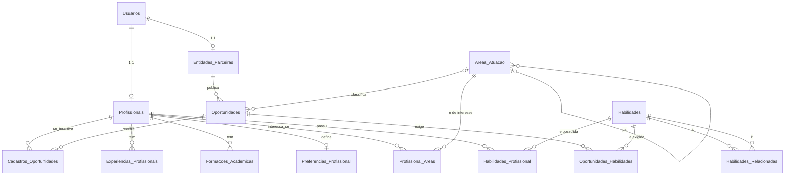

# Banco de dados do ELAB

MySQL/MariaDB, 14 tabelas, InnoDB, `utf8mb4_unicode_ci`. O esquema é criado por migrations (001 a 020); como rodá-las e as garantias do runner estão em [../../backend/db/README.md](../../backend/db/README.md).

## 1. Modelo entidade-relacionamento



Relacionamentos N:N resolvidos por tabelas de junção, algumas com atributos próprios:

| Junção | Liga | Atributos do relacionamento |
|---|---|---|
| `Cadastros_Oportunidades` | Profissionais × Oportunidades | mensagem, protocolo, data_aplicacao |
| `Habilidades_Profissional` | Profissionais × Habilidades | tempo_experiencia_anos |
| `Profissional_Areas` | Profissionais × Areas_Atuacao | interesse (1 a 5) |
| `Oportunidades_Habilidades` | Oportunidades × Habilidades | importancia (1 a 5), obrigatoria |
| `Habilidades_Relacionadas` | Habilidades × Habilidades | peso (0 a 1], aresta do grafo |

`Areas_Atuacao` é autorrelacionada (`Area_Pai_idArea`) e forma a árvore de áreas usada pelo motor. `Habilidades` e `Habilidades_Relacionadas` formam o grafo de habilidades.

## 2. Dicionário de dados

Legenda: **PK** chave primária, **FK** chave estrangeira, **UQ** único, **NN** não nulo. Todas as FKs usam `ON UPDATE CASCADE`; o comportamento na exclusão está indicado.

### Usuarios
Conta de acesso, comum a colaboradoras, empresas e administradora.

| Coluna | Tipo | Regra |
|---|---|---|
| idUsuario | int | PK, auto incremento |
| email | varchar(255) | NN, UQ |
| senha | varchar(255) | NN, hash bcrypt |
| tipo_usuario | enum | NN: `profissional`, `entidade_parceira`, `admin` |
| data_registro | datetime | NN, padrão agora |

### Profissionais
Perfil da colaboradora, 1:1 com `Usuarios`.

| Coluna | Tipo | Regra |
|---|---|---|
| idProfissionais | int | PK |
| Usuario_idUsuario | int | NN, UQ, FK para Usuarios, exclusão em cascata |
| nome | varchar(255) | NN |
| area, titulo_profissional, bio | varchar | texto livre de apresentação |
| resumo | text | texto livre |
| telefone, cidade | varchar | |
| estado | enum | UF brasileira |
| link_github, link_linkedin, link_portfolio | varchar(255) | |
| nivel | enum | `estagio`, `junior`, `pleno`, `senior`, `especialista` |
| anos_experiencia | tinyint | |
| disponibilidade | enum | NN, padrão `imediata` |
| curriculo_arquivo, curriculo_nome_original, curriculo_atualizado_em | varchar, varchar, datetime | currículo enviado |
| perfil_publico | tinyint(1) | NN, padrão 1 |

### Preferencias_Profissional
Preferências de busca, 1:1 com `Profissionais`.

| Coluna | Tipo | Regra |
|---|---|---|
| Profissionais_idProfissionais | int | PK e FK, exclusão em cascata |
| modalidade | enum | NN, padrão `indiferente` (`remoto`, `hibrido`, `presencial`, `indiferente`) |
| aceita_clt, aceita_pj, aceita_estagio, aceita_mudar_cidade | tinyint(1) | NN, indicadores |
| pretensao_min | decimal(10,2) | pretensão salarial mínima |
| interesse_vagas, interesse_eventos, interesse_palestras, interesse_bolsas | tinyint(1) | NN, padrão 1 |

### Experiencias_Profissionais
| Coluna | Tipo | Regra |
|---|---|---|
| idExperiencia | int | PK |
| Profissionais_idProfissionais | int | NN, FK, exclusão em cascata, indexada |
| cargo, empresa | varchar(150) | NN |
| local | varchar(150) | |
| data_inicio | date | NN |
| data_fim | date | nula se atual |
| atual | tinyint(1) | NN, padrão 0 |
| descricao | text | |

### Formacoes_Academicas
| Coluna | Tipo | Regra |
|---|---|---|
| idFormacao | int | PK |
| Profissionais_idProfissionais | int | NN, FK, exclusão em cascata, indexada |
| instituicao, curso | varchar(150) | NN |
| grau | enum | NN: `tecnico`, `graduacao`, `pos`, `mestrado`, `doutorado`, `bootcamp`, `curso_livre` |
| status | enum | NN, padrão `concluido` (`concluido`, `cursando`, `trancado`) |
| data_inicio, data_fim | date | |

### Entidades_Parceiras
Perfil da empresa, 1:1 com `Usuarios`.

| Coluna | Tipo | Regra |
|---|---|---|
| idEntidade_Parceira | int | PK |
| Usuario_idUsuario | int | NN, UQ, FK para Usuarios, exclusão em cascata |
| nome_organizacao | varchar(255) | NN |
| descricao | varchar(255) | |
| cnpj | varchar(14) | NN, UQ (dígitos validados na API) |
| tipo_entidade | varchar(45) | |
| status_aprovacao | enum | NN, padrão `pendente` (`pendente`, `aprovada`, `rejeitada`). Não é usado pela API: só o seed:demo o preenche. |

### Areas_Atuacao
Árvore de áreas.

| Coluna | Tipo | Regra |
|---|---|---|
| idArea | int | PK |
| nome | varchar(100) | NN |
| slug | varchar(100) | NN, UQ |
| Area_Pai_idArea | int | FK para a própria tabela, indexada, `ON DELETE SET NULL` |

### Profissional_Areas
| Coluna | Tipo | Regra |
|---|---|---|
| Profissionais_idProfissionais, Area_idArea | int | PK composta, ambas FK com exclusão em cascata |
| interesse | tinyint | NN, padrão 3, `CHECK` entre 1 e 5 |

### Habilidades
Catálogo e vértices do grafo.

| Coluna | Tipo | Regra |
|---|---|---|
| idHabilidades | int | PK |
| nome_habilidade | varchar(100) | NN, UQ |
| categoria | varchar(50) | indexada |

### Habilidades_Relacionadas
Arestas ponderadas do grafo de habilidades.

| Coluna | Tipo | Regra |
|---|---|---|
| Habilidade_A, Habilidade_B | int | PK composta, ambas FK para Habilidades, exclusão em cascata |
| peso | decimal(3,2) | NN, `CHECK` maior que 0 e até 1 |

### Habilidades_Profissional
| Coluna | Tipo | Regra |
|---|---|---|
| Profissionais_idProfissionais, Habilidades_idHabilidades | int | PK composta, ambas FK com exclusão em cascata |
| tempo_experiencia_anos | int | |

### Oportunidades
Vagas, eventos, palestras e bolsas na mesma tabela, diferenciados por `tipo`.

| Coluna | Tipo | Regra |
|---|---|---|
| idOportunidade | int | PK |
| Entidade_Parceira_idEntidade_Parceira | int | NN, FK, exclusão em cascata, indexada |
| titulo | varchar(255) | NN |
| descricao | text | |
| tipo | enum | NN: `vaga`, `evento`, `palestra`, `bolsa` |
| local | varchar(255) | |
| data | date | data do evento ou prazo |
| status | enum | NN, padrão `ativo` (`ativo`, `agendado`, `encerrado`) |
| data_postagem | datetime | NN, padrão agora |
| Area_idArea | int | FK para Areas_Atuacao, `ON DELETE SET NULL`, indexada |
| nivel | enum | NN, padrão `qualquer` |
| modalidade | enum | `remoto`, `hibrido`, `presencial` |
| salario_min, salario_max | decimal(10,2) | |

### Oportunidades_Habilidades
Requisitos de uma vaga.

| Coluna | Tipo | Regra |
|---|---|---|
| Oportunidade_idOportunidade, Habilidade_idHabilidades | int | PK composta, ambas FK com exclusão em cascata |
| importancia | tinyint | NN, padrão 3, `CHECK` entre 1 e 5 |
| obrigatoria | tinyint(1) | NN, padrão 0 |

### Cadastros_Oportunidades
Candidaturas e inscrições.

| Coluna | Tipo | Regra |
|---|---|---|
| Oportunidade_idOportunidade, Profissionais_idProfissionais | int | PK composta (impede inscrição repetida), ambas FK com exclusão em cascata |
| mensagem | text | |
| protocolo | varchar(20) | |
| data_aplicacao | datetime | NN, padrão agora |

## 3. Normalização

- **1FN:** todas as colunas são atômicas; listas (habilidades, áreas, requisitos, inscrições) viraram tabelas de junção em vez de colunas multivaloradas. A tabela `Habilidades_Oportunidade` (texto livre) foi removida na migration 020 justamente por violar essa ideia.
- **2FN:** as junções têm chave composta e seus atributos dependem da chave inteira (por exemplo, `importancia` depende do par vaga e habilidade).
- **3FN:** dados de empresa ficam em `Entidades_Parceiras` e não repetidos em cada vaga; credenciais ficam em `Usuarios`, separadas dos perfis.
- **Escolha de projeto:** vagas, eventos, palestras e bolsas compartilham `Oportunidades`, com colunas de vaga (`nivel`, `modalidade`, salário) nulas ou padrão nos demais tipos. Evita quatro tabelas quase iguais ao custo de algumas colunas vazias.
- **Desvios assumidos:** `Profissionais.area` e `Profissionais.bio` são texto livre e coexistem com a estrutura `Profissional_Areas`; `Experiencias_Profissionais.empresa` é texto e não FK, porque a empresa de uma experiência passada não precisa ter conta na plataforma.

## 4. Integridade e índices

- **Chaves estrangeiras:** todas as relações têm FK com `ON UPDATE CASCADE`. Excluir um usuário apaga em cascata seu perfil, suas inscrições e seus itens de perfil. `Areas_Atuacao.Area_Pai_idArea` e `Oportunidades.Area_idArea` usam `SET NULL`.
- **Unicidade:** e-mail, CNPJ, slug de área, nome de habilidade e os vínculos 1:1 com `Usuarios`.
- **`CHECK`:** `peso` entre 0 (exclusivo) e 1; `importancia` e `interesse` entre 1 e 5.
- **Índices de apoio às consultas:** FKs usadas em junção têm índice (`idx_co_profissional`, `idx_oh_habilidade`, `idx_hp_habilidade`, `idx_pa_area`, `idx_hr_b`, `idx_oportunidades_entidade`, `idx_oport_area`, `idx_exp_profissional`, `idx_form_profissional`, `idx_area_pai`) e a categoria de habilidade. As colunas de chave composta já são cobertas pelo índice da PK.
- **Regras só na API, não no banco:** data de fim posterior à de início, salário máximo maior que o mínimo e validade do CNPJ. Uma violação por fora da API passaria.
- **Sem índice em `Oportunidades.tipo` e `status`**, usados nos filtros de listagem: com dezenas de linhas não faz diferença; com volume grande valeria um índice composto.
- Não há views, procedures nem triggers.

## 5. Consultas principais

Histórico da colaboradora (`inscricoes.repository.js`):

```sql
SELECT o.idOportunidade AS oportunidadeId, o.titulo, o.tipo, o.status, e.nome_organizacao AS empresaNome,
       c.protocolo, c.mensagem, c.data_aplicacao AS dataInscricao
FROM Cadastros_Oportunidades c
JOIN Oportunidades o ON o.idOportunidade = c.Oportunidade_idOportunidade
JOIN Entidades_Parceiras e ON e.idEntidade_Parceira = o.Entidade_Parceira_idEntidade_Parceira
WHERE c.Profissionais_idProfissionais = ?
ORDER BY c.data_aplicacao DESC, o.idOportunidade DESC;
```

Inscritas em uma oportunidade (`candidatos.repository.js`):

```sql
SELECT p.idProfissionais AS profissionalId, p.nome, u.email, c.mensagem, c.data_aplicacao AS data_inscricao
FROM Cadastros_Oportunidades c
JOIN Profissionais p ON c.Profissionais_idProfissionais = p.idProfissionais
JOIN Usuarios u ON p.Usuario_idUsuario = u.idUsuario
WHERE c.Oportunidade_idOportunidade = ?;
```

Requisitos de vagas para o motor (`match.repository.js`):

```sql
SELECT Oportunidade_idOportunidade AS vagaId, Habilidade_idHabilidades AS habilidadeId, importancia, obrigatoria
FROM Oportunidades_Habilidades
WHERE Oportunidade_idOportunidade IN (?, ?, ...);
```

## 6. Inconsistências de nomenclatura conhecidas

Não foram corrigidas porque renomear exigiria migration e mudança em todo o código; ficam registradas para não confundir quem ler o esquema.

- Chaves primárias com padrões diferentes: `idUsuario`, `idProfissionais` (plural), `idEntidade_Parceira`, `idOportunidade`, `idHabilidades` (plural), `idArea`.
- `Habilidades_Profissional` usa `Habilidades_idHabilidades`, enquanto `Oportunidades_Habilidades` usa `Habilidade_idHabilidades`.
- Colunas de vínculo seguem `Tabela_idChave` (`Usuario_idUsuario`, `Area_idArea`), exceto `Habilidade_A` e `Habilidade_B` em `Habilidades_Relacionadas`.
- Tabelas misturam singular e plural, e `Cadastros_Oportunidades` guarda inscrições também de eventos, palestras e bolsas.
