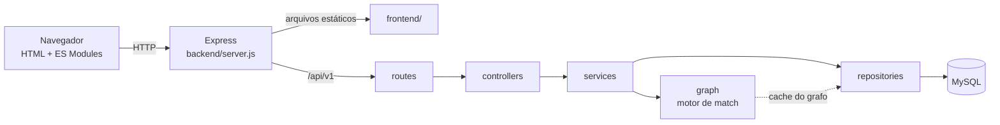

# Arquitetura do ELAB

## 1. Visão geral

Aplicação web em duas partes servidas pelo mesmo processo: um backend Node.js com Express, que expõe uma API REST em `/api/v1`, e um frontend em HTML, CSS e JavaScript (ES Modules, sem framework), servido como arquivos estáticos pelo próprio Express. Os dados ficam em MySQL/MariaDB.

Por ser a mesma origem, o navegador não faz requisições entre origens diferentes.

## 2. Camadas do backend

| Camada | Pasta | Responsabilidade |
|---|---|---|
| Rotas | `src/routes/` | Caminhos, validação de entrada (express-validator), autenticação e permissão por papel |
| Controllers | `src/controllers/` | Lê a requisição, chama o service e devolve a resposta no formato padrão |
| Services | `src/services/` | Regras de negócio (inscrição duplicada, posse da vaga, hash de senha, token, cálculo de match) |
| Repositories | `src/repositories/` | Consultas SQL com prepared statements |
| Motor de grafos | `src/graph/` | Grafo de habilidades, Dijkstra, árvore de áreas, emparelhamento húngaro e pontuação |
| Middlewares | `src/middlewares/` | `auth.middleware` (autenticar e permitir), `validate`, `rateLimiter`, `upload`, `error.middleware` |
| Utilitários | `src/utils/` | `ApiError`, `asyncHandler`, `response`, `cnpj` |
| Configuração | `src/config/` | Leitura e validação das variáveis de ambiente antes de subir o servidor |
| Banco | `db/` | Pool de conexões, transações, runner de migrations e seeds |

Regra de dependência: cada camada só chama a de baixo. Controllers não acessam o banco; repositories não conhecem regras de negócio.

## 3. Pipeline de uma requisição

Ordem registrada em `server.js`:

1. `helmet`: cabeçalhos de segurança, incluindo CSP.
2. `cors`.
3. `express.json` com limite de 10 KB.
4. `morgan`: log (formato `dev` fora de produção, `combined` em produção).
5. Rotas da API: `/auth`, `/oportunidades`, `/perfil`, `/catalogo`, `/match` e `/status`.
6. Arquivos estáticos de `frontend/`.
7. Resposta 404 para rota inexistente.
8. `tratarErros`, sempre por último: `ApiError` vira a resposta com o status previsto; qualquer outro erro vira 500 genérico, sem expor detalhes.

Formato padrão: sucesso `{ "sucesso": true, "dados": ... }`; erro `{ "sucesso": false, "erro": "mensagem" }`.

## 4. Autenticação e autorização

- Login devolve um JWT. O token carrega o papel (`profissional`, `entidade_parceira` ou `admin`).
- `autenticar` valida o token; `permitir('colaboradora' | 'empresa')` restringe a rota ao papel, e `colaboradora` e `empresa` são mapeados para os papéis do token.
- Posse de recurso é verificada no service, não só pelo papel: a empresa só vê as candidaturas das próprias vagas.

## 5. Banco de dados

Detalhes em [../../backend/db/README.md](../../backend/db/README.md). Pontos de arquitetura:

- Esquema evolui por **migrations numeradas** (001 a 020), com lock distribuído e checksum; uma migration aplicada nunca é editada.
- Operações compostas usam `withTransaction` (por exemplo, criar vaga e seus requisitos).
- Eventos, palestras e bolsas compartilham a tabela `Oportunidades` com as vagas (coluna `tipo`); inscrições ficam em `Cadastros_Oportunidades`.
- A migration 020 removeu tabelas sem uso (`Eventos`, `Cadastros_Eventos`, `Habilidades_Oportunidade`).

## 6. Frontend

- Cada página HTML é um esqueleto; a lógica fica em `frontend/js/pages/` (um módulo por página).
- Código compartilhado em `frontend/js/core/`: `api` (chamadas e token), `state`, `dom` (escape de texto), `forms`, `render`, `lista` (busca, filtros e paginação), `match`, `candidatas` e `vagaForm`.
- Sem JavaScript inline, por causa da CSP do `helmet`.
- Todo texto vindo do usuário é escapado antes de entrar no HTML.

## 7. Decisões de projeto

| Decisão | Motivo | Consequência |
|---|---|---|
| Camadas routes, controllers, services e repositories | Separar HTTP, regra de negócio e SQL | Trocar o banco exige mexer só nos repositories |
| Frontend servido pelo Express | Mesma origem, sem configuração de CORS | Um único processo para executar e apresentar |
| JWT em vez de sessão no servidor | API sem estado | Sem revogação antes da expiração |
| Migrations versionadas com checksum | Banco reproduzível entre máquinas | Mudança de esquema sempre vira migration nova |
| Prepared statements em todas as consultas | Evitar injeção de SQL | Consultas com lista dinâmica montam os `?` por quantidade |
| Grafo e árvore de áreas em cache de memória | Evitar recarregar a cada requisição | Alterar arestas exige invalidar o cache |
| Filtros e paginação no navegador | Simplicidade com o volume atual | Não escala para listas muito grandes |
| Seed de catálogo separado do seed de demonstração | Catálogo sem dados falsos; demo reproduzível | `seed:demo` é destrutivo |

## 8. Limitações arquiteturais

- O token fica em `localStorage`, legível por qualquer script da própria página. A CSP restritiva e o escape de saída reduzem o risco, mas não o eliminam.
- O CORS está aberto (`cors()` sem restrição); há um TODO no `server.js` para restringir a origem se o frontend for hospedado em outro domínio.
- Sem renovação nem revogação de token.
- Cache do grafo é por processo: com várias instâncias, cada uma teria o seu.
- Alguns serviços consultam o banco em loop (uma consulta por candidata ou por vaga), adequado ao volume atual.
- Não há deploy configurado: a execução é local, com MySQL e Node instalados.
