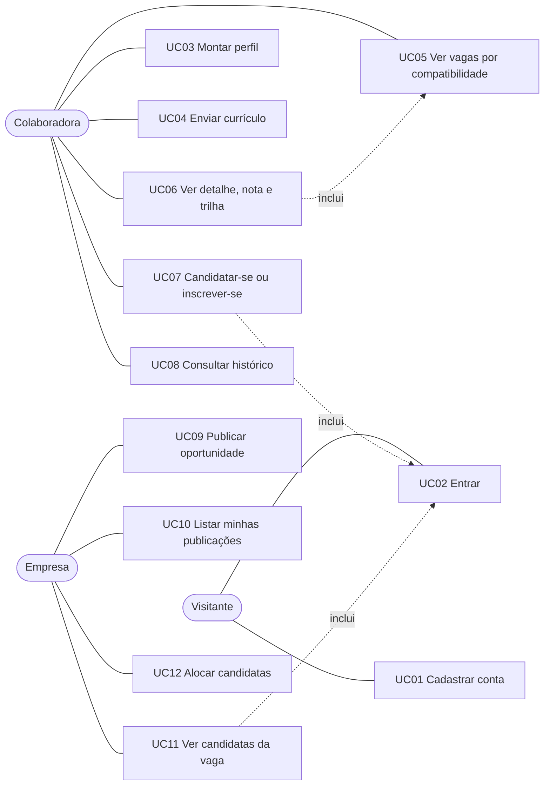

# Casos de uso do ELAB

Atores: **Visitante**, **Colaboradora** e **Empresa**. Os requisitos citados estão em [requisitos.md](requisitos.md) e as histórias em [historias-de-usuario.md](historias-de-usuario.md).

> Nos nomes técnicos da API, a colaboradora é o tipo `profissional` e a empresa é `entidade_parceira`. Erros seguem o formato `{ "sucesso": false, "erro": "mensagem" }`; erros inesperados devolvem 500 com mensagem genérica.

## 1. Diagrama

## 2. Descrição dos casos de uso

### UC01. Cadastrar conta
- **Ator:** Visitante. **Requisitos:** RF01, RF02. **História:** HU01.
- **Pré-condição:** nenhuma.
- **Fluxo principal:**
  1. O visitante abre `registro.html` e escolhe o tipo de conta.
  2. Informa nome, e-mail e senha (e CNPJ, se for empresa).
  3. O sistema valida os dados, grava a conta com a senha em hash e confirma o cadastro.
- **Fluxos alternativos:**
  - 3a. Dado inválido (e-mail, senha com menos de 8 caracteres, CNPJ inválido): resposta 400 com a mensagem do campo.
  - 3b. E-mail ou CNPJ já cadastrado: resposta 409, nenhuma conta é criada.
  - 3c. Mais de 20 tentativas em 15 minutos pelo mesmo IP: resposta 429.
- **Pós-condição:** conta criada e pronta para login.

### UC02. Entrar
- **Ator:** Visitante. **Requisitos:** RF03, RF04. **História:** HU02.
- **Fluxo principal:**
  1. O visitante informa e-mail e senha em `login.html`.
  2. O sistema confere as credenciais e devolve um token com validade de 2 horas (padrão).
  3. O navegador guarda o token e leva o usuário ao feed.
- **Fluxos alternativos:**
  - 2a. Credenciais incorretas: resposta 401.
  - 2b. Limite de tentativas excedido: resposta 429.
- **Pós-condição:** sessão aberta com o papel da conta.

### UC03. Montar perfil
- **Ator:** Colaboradora. **Requisitos:** RF05 a RF09, RF11. **História:** HU03.
- **Pré-condição:** autenticada como colaboradora.
- **Fluxo principal:**
  1. Abre `editar-perfil.html`.
  2. Preenche dados pessoais, experiências, formações, áreas com nível de interesse, habilidades com anos e preferências.
  3. O sistema valida e salva cada bloco e atualiza a barra de completude.
- **Fluxos alternativos:**
  - 3a. Data de fim anterior à de início: resposta 400.
  - 3b. Item de experiência ou formação inexistente ao apagar: resposta 404.
  - 3c. Empresa tenta acessar: resposta 403.
- **Pós-condição:** perfil atualizado e disponível ao motor de compatibilidade.

### UC04. Enviar currículo
- **Ator:** Colaboradora. **Requisitos:** RF10, RNF07. **História:** HU04.
- **Fluxo principal:** envia um PDF ou DOCX de até 5 MB; o sistema valida e guarda; ela pode baixar ou remover depois.
- **Fluxos alternativos:**
  - Arquivo falso ou de extensão não permitida: rejeitado.
  - Download ou remoção sem currículo enviado: resposta 404.

### UC05. Ver vagas por compatibilidade
- **Ator:** Colaboradora. **Requisitos:** RF12, RF13, RF22. **História:** HU05.
- **Fluxo principal:**
  1. Abre o feed.
  2. O sistema calcula a nota de cada vaga ativa para o perfil dela e ordena do maior para o menor.
  3. Ela busca, filtra e pagina a lista.
- **Fluxo alternativo:** perfil sem habilidades ou áreas gera notas baixas, sem erro.

### UC06. Ver detalhe, nota e trilha
- **Ator:** Colaboradora. **Requisitos:** RF23, RF24. **Histórias:** HU06, HU07.
- **Fluxo principal:**
  1. Abre o detalhe de uma vaga.
  2. O sistema mostra a nota por componente, a situação de cada requisito e a trilha de aprendizado até as habilidades faltantes.
- **Fluxos alternativos:**
  - Vaga inexistente: resposta 404. Identificador inválido: resposta 400.
  - Habilidade sem caminho no grafo: aparece como não alcançável.
  - Evento, palestra ou bolsa não têm nota nem trilha.

### UC07. Candidatar-se ou inscrever-se
- **Ator:** Colaboradora. **Requisitos:** RF17, RF18. **História:** HU08.
- **Pré-condição:** autenticada como colaboradora e com perfil profissional.
- **Fluxo principal:**
  1. No detalhe, escolhe candidatar-se (vaga) ou inscrever-se (demais tipos).
  2. Escreve uma mensagem opcional de até 500 caracteres.
  3. O sistema registra, gera um protocolo e mostra a confirmação.
- **Fluxos alternativos:**
  - 3a. Já inscrita nessa oportunidade: resposta 409.
  - 3b. Oportunidade inexistente: resposta 404.
  - 3c. Mensagem longa demais: resposta 400.
  - 3d. Empresa tenta se inscrever: resposta 403.
- **Pós-condição:** inscrição gravada, visível no histórico e para a empresa dona.

### UC08. Consultar histórico
- **Ator:** Colaboradora. **Requisitos:** RF19. **História:** HU09.
- **Fluxo principal:** abre o perfil; o sistema lista candidaturas e inscrições, da mais recente para a mais antiga, com a nota nas vagas; ela busca e filtra por tipo.
- **Fluxo alternativo:** sem registros, a lista mostra a mensagem de vazio.

### UC09. Publicar oportunidade
- **Ator:** Empresa. **Requisitos:** RF14, RF15. **História:** HU10.
- **Fluxo principal:**
  1. Abre o painel e escolhe o tipo (vaga, evento, palestra ou bolsa).
  2. Informa título e descrição; para vagas, também área, nível, modalidade, faixa salarial e requisitos com importância e obrigatoriedade.
  3. O sistema valida, grava a publicação e os requisitos em uma transação, e a lista é atualizada.
- **Fluxos alternativos:**
  - 3a. Salário máximo menor que o mínimo, nível ou modalidade inválidos, importância fora de 1 a 5: resposta 400, nada é gravado.
  - 3b. Área ou habilidade inexistente: resposta 400.
  - 3c. Colaboradora tenta publicar: resposta 403.
- **Pós-condição:** vaga `ativo` ou demais tipos `agendado`; vagas entram no ranking das colaboradoras.

### UC10. Listar minhas publicações
- **Ator:** Empresa. **Requisitos:** RF16. **História:** HU11.
- **Fluxo principal:** o painel lista as publicações da empresa, com busca, filtro por tipo e paginação.

### UC11. Ver candidatas da vaga
- **Ator:** Empresa. **Requisitos:** RF20, RF21. **História:** HU12.
- **Fluxo principal:**
  1. Abre o detalhe de uma vaga própria.
  2. O sistema calcula a nota de cada inscrita e ordena por compatibilidade, com habilidades faltantes e aviso de requisito obrigatório ausente.
  3. A empresa filtra por faixa de compatibilidade e por requisito obrigatório.
- **Fluxos alternativos:**
  - Vaga de outra empresa: resposta 403, e o bloco não aparece.
  - Vaga inexistente: resposta 404.
  - Evento, palestra ou bolsa: lista sem nota, por data de inscrição.

### UC12. Alocar candidatas
- **Ator:** Empresa. **Requisitos:** RF25. **História:** HU13.
- **Fluxo principal:**
  1. Solicita a alocação entre as próprias vagas.
  2. O sistema monta a matriz de notas e resolve o emparelhamento de peso máximo.
  3. Devolve os pares candidata e vaga, descartando os de nota abaixo de 40, e o total.
- **Fluxos alternativos:**
  - Empresa sem vagas: resposta 200 com nenhuma alocação.
  - Colaboradora: resposta 403. Sem token: resposta 401.
